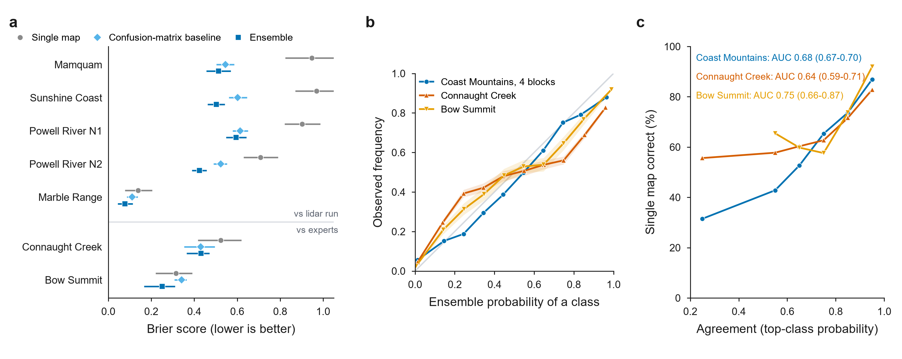
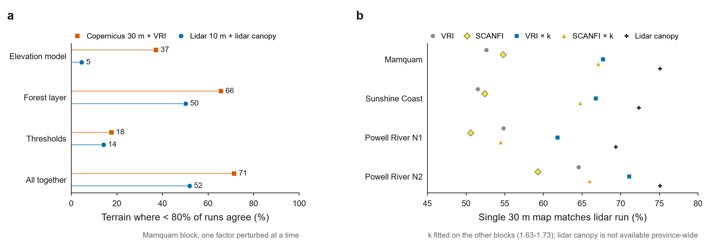

# autoates-bc

**How far can an automated avalanche terrain map be trusted?**
Propagating input uncertainty through AutoATES v2.0 in the Coast Mountains of
British Columbia.

Automated ATES maps give every grid cell one class and no measure of how
reliable it is. This repository reimplements the AutoATES v2.0 chain so that it
runs in seconds, verifies it against the published code and data, propagates
elevation, forest and threshold uncertainty through it by Monte Carlo
simulation, and tests the resulting class probabilities on five lidar-covered
blocks (leave one out) and two expert benchmark sites.

**Manuscript:** [paper/manuscript.md](paper/manuscript.md) (draft, not peer reviewed).
**Cite:** see [CITATION.cff](CITATION.cff).

> **Research only.** ATES describes terrain, not conditions on a given day.
> Nothing here is suitable for deciding whether a slope or route is safe. Use
> the public avalanche forecast and appropriate training.


## Main results

Five 10.5 km × 8.4 km blocks with full lidar coverage, four in the Coast
Mountains. For each block the elevation error model and forest scale factors
are fitted on the other four, and a 120-member ensemble built from Copernicus
GLO-30 and the BC forest inventory (VRI) is scored against the block's own
lidar-based map. Brackets: 95 % intervals from a 1.5 km spatial block bootstrap.

| | Coast Mountains, 4 blocks pooled |
|---|---|
| Single 30 m map matches lidar-based map | 55.9 % (53.4–58.2) |
| Ensemble's most likely class matches | 63.5 % (61.4–65.5) |
| Expected calibration error | 0.04 (0.03–0.05) |
| Brier skill vs. single map scored one-hot | 0.42 |
| **Brier skill vs. confusion-matrix baseline** (fitted on the other blocks) | **0.11 (0.09–0.13)** |
| AUC of ensemble agreement for "single map is right" | 0.68 (0.67–0.70) |
| Under-rated cells caught by flagging 22 % of the area | 58 % (56–60) |

Against the expert benchmark maps of Sykes et al. (2024), agreement again ranks
cells by whether the single map is right (AUC 0.64 at Connaught Creek, 0.75 at
Bow Summit), but the probabilities are overconfident and the most likely class
is no more accurate than a single calibrated run.



Forest cover dominated the uncertainty with and without lidar elevation. VRI
and the national SCANFI product read 10–26 points below lidar canopy cover in
the Coast Mountains blocks. One scale factor fitted on other blocks (1.63–1.73)
raised single-map agreement from 55.9 % to 66.9 % with VRI.



**Bottom line.** The useful product is an agreement layer that tells reviewers
where an automated map is fragile. It does not make the map more accurate, and
the gain over a fair baseline is modest (11 % in Brier skill), much smaller than
the 42 % a comparison against a single map suggests.

All figures (PNG at 400 dpi and vector PDF) are in
[results/figures](results/figures); every number is in
[results/statistics.json](results/statistics.json),
[results/multi_area.json](results/multi_area.json),
[results/benchmark.json](results/benchmark.json) and
[results/summary.json](results/summary.json).

## Verification of the reimplementation

| Check | Result |
|---|---|
| Classifier on the bundled Bow Summit inputs | all seven intermediate rasters identical to the bundled outputs |
| Release-area model on the bundled test DEM | release layers identical; wind shelter within 10⁻⁵ |
| Flow-Py vs. the unmodified upstream code | identical cell counts; other outputs within 10⁻³ |
| Full chain at the benchmark sites | 98.5 % and 99.2 % of cells identical to the archived maps; published accuracies 75.1 % and 84.4 % reproduced |

One warm run of the full chain on a 10 m, 840 × 1050 grid takes about 13 s on a
32-thread desktop processor. The four comparisons run with `pytest`.

### Note on the Bow Summit archive

In the archived Bow Summit inputs the forest density layer passed to Flow-Py is
−9999 in 14,221 of 31,118 study-area cells (where basal area is 0). Flow-Py does
not treat that value as missing, and flows over open terrain stop early. Passing
the layer as archived reproduces the published 84.4 %; setting those cells to 0
gives 78.1 %. `scripts/07_bow_summit_density_check.py` reproduces this. Whether it was
intended has not been confirmed with the authors, so this is an observation
about the archived files, not a claim of an error in the paper.

## Repository

```
src/autoates_bc/      pra.py, flowpy.py (numba), classifier.py, pipeline.py,
                      uncertainty.py (Monte Carlo), sites.py (study blocks)
tests/                comparison with the upstream code and data
scripts/01-02         Mamquam inputs and within-block experiments
scripts/03            summary of the within-block experiments
scripts/04            east/west split of Mamquam (superseded by 09)
scripts/05, 11        manuscript figures
scripts/06-07         expert benchmark sites; Bow Summit archive check
scripts/08-09         five-block inputs and leave-one-block-out test
scripts/10            block-bootstrap scores and intervals
paper/                manuscript
docs/                 conference abstract draft
```

## Reproduce

```bash
git clone https://github.com/AutoATES/AutoATES-v2.0 vendor/AutoATES-v2.0
python -m pip install -e ".[dev]" pyreadr pandas pyshp
python -m pytest
python scripts/01_fetch_data.py
python scripts/02_run_experiments.py
python scripts/03_analyze.py
python scripts/06_benchmark_sites.py
python scripts/08_fetch_sites.py
python scripts/09_multi_area.py
python scripts/10_statistics.py
python scripts/05_figures.py
python scripts/11_paper_figures.py
```

`06` needs the OSF archives named in its docstring in `data/osf/`; `11` needs
Natural Earth admin-1 and lakes (10 m) in `data/ne/`. A full run takes several
hours on a 32-thread desktop.

## Data

NRCan HRDEM mosaic (CanElevation, Open Government Licence – Canada); Copernicus
DEM GLO-30 (© DLR e.V. 2010–2014 and © Airbus Defence and Space GmbH 2014–2018,
provided under COPERNICUS by the European Union and ESA); BC Vegetation
Resources Inventory (Open Government Licence – British Columbia); SCANFI
(Guindon et al., 2024, https://doi.org/10.23687/18e6a919-53fd-41ce-b4e2-44a9707c52dc);
benchmark maps and inputs from OSF project
[zxjw5](https://doi.org/10.17605/OSF.IO/ZXJW5) (GPL-3.0); Natural Earth
(public domain).

## Licence and credit

GPL-3.0-or-later, as the port derives from AutoATES v2.0 (Toft et al., 2024)
and Flow-Py (D'Amboise et al., 2022), both GPL-3.0. The release-area model
follows Veitinger et al. (2016) and Sharp (2018). Full references are in the
manuscript.
