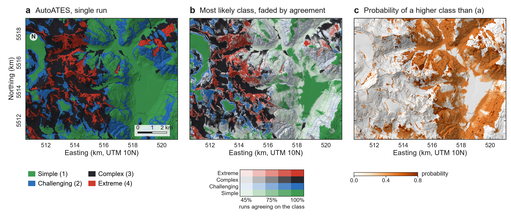
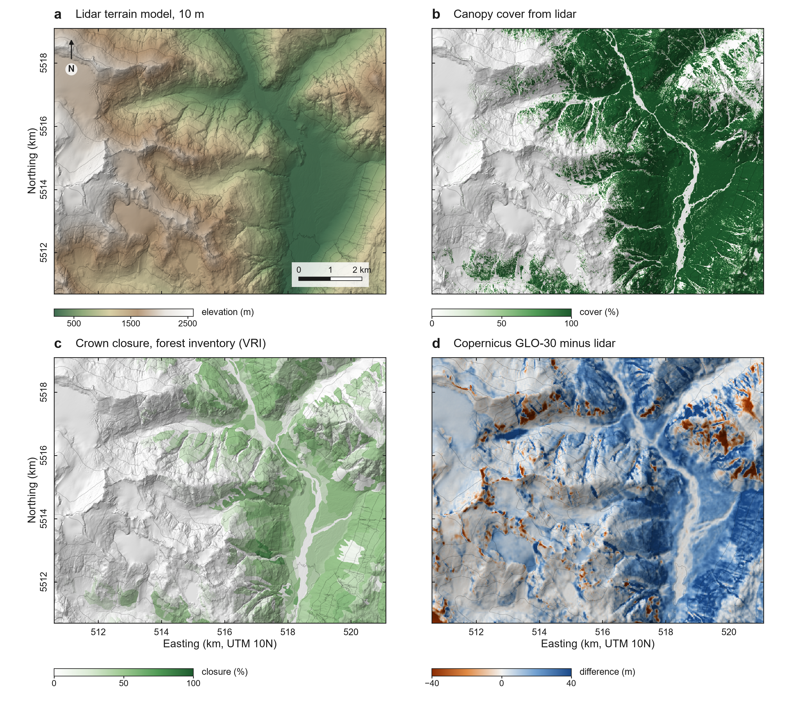
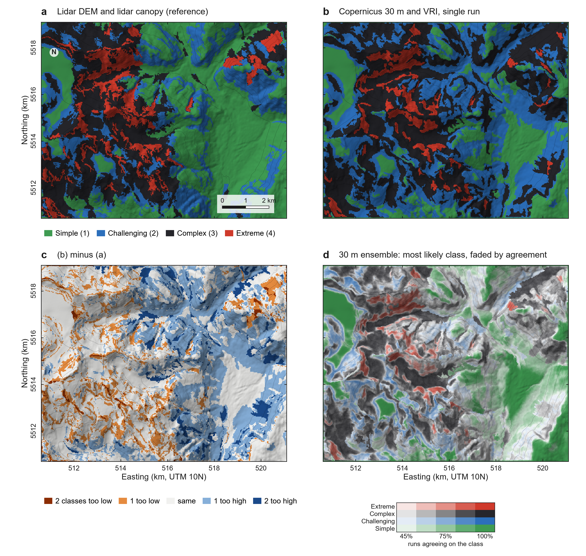
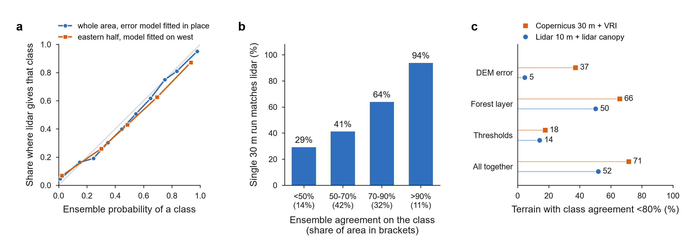
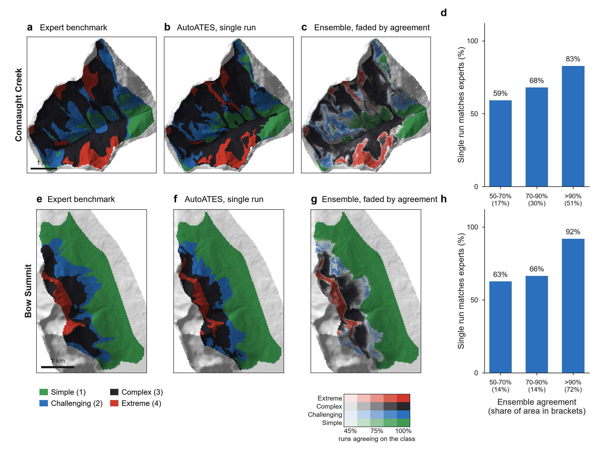
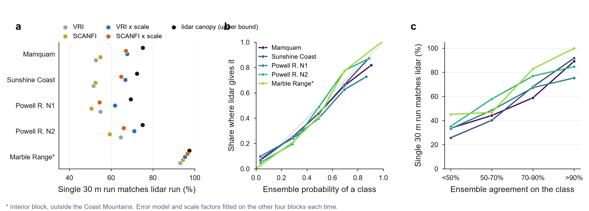

# autoates-bc

AutoATES v2.0 gives every cell of a mountain one avalanche terrain class and no
indication of how much to trust it. This project reruns the whole AutoATES chain
many times with perturbed inputs and thresholds, so each cell gets a probability
for each class, and then checks whether those probabilities mean anything.

**Research and learning only.** ATES describes terrain, not conditions on a given
day. Nothing here is a tool for deciding whether a slope or a route is safe. In
the backcountry, rely on the public avalanche forecast and proper training.



## What is in here

1. **A checked port of AutoATES v2.0** ([Toft et al. 2024](https://nhess.copernicus.org/articles/24/1779/2024/))
   that runs in memory: the PRA model, Flow-Py with forest detrainment (rewritten
   with numba), and the classifier. Four tests compare it with the upstream
   repository: the classifier and PRA outputs match the bundled rasters cell for
   cell, and the Flow-Py port matches the unmodified upstream Python on cell
   counts exactly and on the other outputs within rounding.
2. **Monte Carlo uncertainty propagation** through the full chain: DEM error as a
   spatially correlated field, forest-layer error and choice of forest product,
   and classifier thresholds drawn from the spread of published calibrations.
3. **A Coast Mountains case** (10.5 x 8.4 km east of the Mamquam Icefield,
   Garibaldi Provincial Park), where no AutoATES validation has been published.
4. **Two tests of the probabilities**: against a lidar-based run in the Coast
   Mountains, and against expert benchmark maps at Connaught Creek and Bow Summit.

One warm run of the whole chain on the 10 m grid (882,000 cells, about 160,000
release cells) takes about 13 s on a 32-thread desktop.

## Data

All open, no login. `scripts/01_fetch_data.py` downloads the Coast Mountains inputs.

| Layer | Source |
|---|---|
| Lidar terrain and surface models, 2 m | NRCan HRDEM Mosaic (CanElevation), averaged to 10 m |
| Canopy cover from lidar | share of 2 m cells where surface minus terrain exceeds 2 m plus a slope allowance |
| 30 m elevation | Copernicus GLO-30 |
| Forest inventory | BC Vegetation Resources Inventory, crown closure |
| Expert benchmark maps, ALOS DEM, basal area | OSF project [zxjw5](https://doi.org/10.17605/OSF.IO/ZXJW5) of [Sykes et al. 2024](https://nhess.copernicus.org/articles/24/947/2024/), GPL-3.0 |



Two configurations are compared in the Coast Mountains block:

- **lidar**: 10 m lidar terrain model and lidar canopy cover. Possible only where lidar exists.
- **province-wide**: Copernicus 30 m and VRI crown closure. Possible anywhere in BC.

## How the uncertainty is modelled

- **DEM, 30 m.** Copernicus minus lidar is measured in eight strata that can be
  built without lidar (Copernicus slope band by VRI forest or open). Each
  realisation removes the stratum bias and adds a Gaussian random field with the
  stratum spread. The correlation length is set so that the simulated slope
  error matches the measured one (5.4 degrees standard deviation).
- **DEM, lidar.** No independent check data, so a nominal 0.5 m is assumed.
- **Forest.** Correlated noise on the forest layer, plus a random choice between
  forest products where two exist.
- **Thresholds.** Uniform over the range of published values: the v2.0 defaults
  and the grid-search optima of Sykes et al. (2024) for two sites and four DEMs.
  PRA and Flow-Py settings are held at the published values, because only one
  value of each has been published. The spread shown here is therefore a lower
  bound on parameter uncertainty.

## Results in the Coast Mountains



**The single province-wide map is a weak stand-in for the lidar map.** They agree
on 52.6% of cells; 12.6% are rated lower than lidar and 34.8% higher.

**The ensemble probabilities are close to honest.** Where the 30 m ensemble
gives a class 75% probability, the lidar run has that class 75% of the time;
at 98% it is 95%. The Brier score falls from 0.95 for the single map to 0.48.

**Ensemble agreement separates good cells from bad.** Where more than 90% of
runs agree (11% of the area) the single 30 m map matches lidar 94% of the time.
Where fewer than half agree (14% of the area) it matches 29% of the time.

**Flagging catches about half of the under-rated terrain.** Marking the 18% of
the area where the chance of a higher class exceeds 20% covers 51% of the cells
that the single map rates too low.

**The forest layer is the largest source of disagreement, with or without lidar.**
Share of terrain whose class holds in fewer than 80% of runs:

| Perturbed | Copernicus 30 m + VRI | Lidar 10 m + lidar canopy |
|---|---|---|
| DEM error | 37% | 5% |
| Forest layer | 66% | 50% |
| Thresholds | 18% | 14% |
| All together | 71% | 52% |

VRI crown closure averages 26 points lower than lidar canopy cover here. They
are not the same quantity, and AutoATES reads both through the same canopy-cover
thresholds. Swapping one for the other on the same lidar DEM changes the class
of 41% of cells.



### Out-of-sample check

The Copernicus error statistics above come from the same block the ensemble is
scored on. `scripts/04_transfer_test.py` refits them on the western half and
scores the eastern half, with a 1.5 km strip dropped between them.

| | East (unseen) | West (fitted) |
|---|---|---|
| Single map matches lidar | 37% | 69% |
| Most likely class matches lidar | 62% | 68% |
| Brier score, single map to ensemble | 1.25 to 0.51 | 0.62 to 0.45 |
| Single-map accuracy where agreement is 90% or more | 97.5% | 90% |
| Single-map accuracy where agreement is under 50% | 25% | 48% |
| Area flagged to under-rated cells caught | 14% to 40% | 17% to 52% |

The probabilities are somewhat overconfident on unseen ground (93% predicted,
87% observed) and the share of under-rated cells caught drops to 40%.

## Against expert benchmark maps

Sykes et al. (2024) published expert ATES benchmark maps for Connaught Creek
(Glacier National Park, BC) and Bow Summit (Banff, AB), with the 26 m ALOS DEM
and basal-area forest layer they used. `scripts/06_benchmark_sites.py` runs the
ensemble there with their site-specific thresholds as the base. The DEM error
model is fitted at Connaught Creek, where a 5 m lidar DEM exists (ALOS slope
error 3.4 degrees standard deviation), and transferred unchanged to Bow Summit.

The port first has to reproduce their result. It does: the full chain from DEM
and forest layer gives a map 98.5% identical to the published one at Connaught
Creek and 99.2% at Bow Summit, and recomputing their accuracy from their own
rasters returns the published 75.1% and 84.4%.



| | Connaught Creek | Bow Summit |
|---|---|---|
| Benchmark cells | 19,649 | 12,462 |
| Single run matches experts | 73.8% | 84.2% |
| Most likely class of ensemble matches experts | 71.2% | 83.5% |
| Brier score, single run to ensemble | 0.52 to 0.43 | 0.32 to 0.25 |
| Single-run accuracy where agreement is over 90% | 83% (51% of area) | 92% (72% of area) |
| Single-run accuracy where agreement is 50 to 70% | 59% (17% of area) | 63% (14% of area) |
| Ensemble says 0.8 to 1.0, experts agree | 79% of the time | 90% of the time |
| Area flagged to under-rated cells caught | 11% to 33% | 12% to 45% |

What this shows:

- **Agreement between runs does point at the cells where AutoATES and the experts
  differ.** Accuracy rises by 24 to 29 points between the low and high
  agreement groups at both sites.
- **The probabilities are overconfident against experts.** A stated 93% is right
  79% of the time at Connaught Creek. The ensemble only varies inputs and
  thresholds; it cannot represent ways in which the model itself differs from
  expert judgement. Against experts the agreement layer is a ranking of where to
  look, not a calibrated probability.
- **The ensemble does not make the map more accurate.** Its most likely class
  matches the experts slightly less often than the single calibrated run.
- **Where three human mappers disagree with each other, the ensemble is also less
  sure, clearly at Bow Summit and weakly at Connaught Creek.** Share of cells
  with under 80% agreement: 45% where the mappers split against 9% where they
  agree at Bow Summit; 36% against 27% at Connaught Creek.

### A reproducibility note on Bow Summit

In the archived Bow Summit inputs, the forest density layer handed to Flow-Py
(`forest_scaled.tif`) is -9999 in 14,221 of the 31,118 study-area cells (46%).
Those are the cells where basal area is 0, and they hold 6,231 of the 7,131
release cells. At Connaught Creek the same layer is 0 where basal area is 0.

Flow-Py does not treat -9999 as missing. Its detrainment term becomes
`max(1e-5, 0.046 * z_delta - 3.0)`, which is negligible while the energy line
height is under about 65 m and larger than the whole flux above it, so flows in
open terrain stop soon after passing that height. The unmodified upstream
Flow-Py code gives the same output as this port on such cells.

| Bow Summit, accuracy against the expert benchmark | Overall | Simple | Challenging | Complex | Extreme |
|---|---|---|---|---|---|
| Archived AutoATES map | 84.4% | 96.6% | 59.9% | 75.6% | 72.1% |
| Rerun, layer passed as archived | 84.2% | 96.7% | 57.4% | 76.8% | 72.1% |
| Rerun, -9999 replaced by 0 | 78.1% | 91.0% | 28.8% | 85.6% | 72.1% |

`scripts/07_bow_summit_density_check.py` reproduces these numbers in under a
minute. I have not yet heard from the authors whether this was intended, so
this is an observation about the archived files, not a claim of an error in
the paper.

## Five blocks, leave one out

`scripts/08_fetch_sites.py` and `scripts/09_multi_area.py` repeat the 30 m test
on five 10.5 x 8.4 km blocks that the public lidar mosaic covers completely:
four in the Coast Mountains (Mamquam, the Sunshine Coast backcountry, and two
in the inlet country north of Powell River) and one interior block in the
Marble Range for contrast. For each block, the Copernicus error model, its
correlation length and the forest scale factors are fitted on the other four
blocks only, and the 120-run ensemble is scored against the held-out block's
own lidar run.



Coast Mountains blocks, VRI as the forest input:

| Block | Single 30 m map matches lidar | Most likely class | Brier, single to ensemble | Single-map accuracy where agreement > 90% | Area flagged to under-rated caught |
|---|---|---|---|---|---|
| Mamquam | 52.6% | 62.5% | 0.95 to 0.51 | 89% (11% of area) | 22% to 60% |
| Sunshine Coast | 51.5% | 62.9% | 0.97 to 0.50 | 92% (8%) | 25% to 66% |
| Powell River N1 | 54.8% | 57.4% | 0.90 to 0.60 | 75% (4%) | 21% to 50% |
| Powell River N2 | 64.6% | 71.1% | 0.71 to 0.42 | 85% (8%) | 20% to 57% |

- **The pattern from Mamquam holds on unseen blocks.** In every Coast Mountains
  block the ensemble halves the Brier score, its most likely class beats the
  single map, and accuracy rises steadily with agreement.
- **The probabilities are slightly overconfident.** Where the ensemble says
  0.87 to 0.91, lidar agrees 73 to 87% of the time. Powell River N1, the
  steepest block (21% extreme terrain, Copernicus slope error 6.9 degrees), is
  the weakest.
- **The Marble Range block says little.** 96% of it is simple terrain, so every
  configuration scores above 93%.

### Province-wide forest layers

Share of cells where a single 30 m run matches the lidar run, mean of the four
Coast Mountains blocks:

| Forest input | Match |
|---|---|
| VRI crown closure as is | 55.9% |
| SCANFI crown closure as is | 54.3% |
| SCANFI x 1.63 to 1.68 | 63.1% |
| VRI x 1.65 to 1.73 | 66.9% |
| Lidar canopy cover (not available province-wide; upper bound) | 73.0% |

Both province-wide products read 10 to 39 points below lidar canopy cover.
Scaling either by a single factor fitted on the other blocks recovers most of
the gap, and the factor barely changes from block to block. Scaled VRI closes
about 11 of the 17 points between raw VRI and lidar canopy. SCANFI, the
national 30 m product, is not better than VRI here once both are scaled.

This is a calibration against lidar canopy cover, which AutoATES' canopy-cover
thresholds may or may not have been tuned to. Whether scaled VRI also brings
the maps closer to expert judgement has not been tested.

## Limits

- The Coast Mountains reference is AutoATES on lidar, not expert judgement. That
  comparison measures sensitivity to input data, not correctness.
- Four Coast Mountains blocks, all within about 120 km of each other, plus one
  interior block that is almost all simple terrain. The North Shore, the
  northern Coast Mountains and Vancouver Island are not covered.
- The lidar error (0.5 m) and the forest noise levels are assumptions.
- The ensemble covers input and threshold uncertainty only. It cannot see errors
  in the structure of the model, such as a release-area model that misses a
  start zone in every run.
- The overhead-exposure layer is scaled by the largest cell count in the scene,
  as upstream does, so it depends on the extent of the study area.
- Forest noise at the benchmark sites (5 m2/ha) is an assumption.
- No full literature review was done. Neither AutoATES paper propagates input
  uncertainty or reports a Coast Mountains validation, but similar work may exist
  elsewhere.

## Reproduce

```bash
git clone https://github.com/AutoATES/AutoATES-v2.0 vendor/AutoATES-v2.0
python -m venv .venv
.venv/Scripts/python -m pip install -e ".[dev]"
.venv/Scripts/python -m pytest
.venv/Scripts/python scripts/01_fetch_data.py
.venv/Scripts/python scripts/02_run_experiments.py
.venv/Scripts/python scripts/03_analyze.py
.venv/Scripts/python scripts/04_transfer_test.py
.venv/Scripts/python scripts/06_benchmark_sites.py
.venv/Scripts/python scripts/07_bow_summit_density_check.py
.venv/Scripts/python scripts/08_fetch_sites.py
.venv/Scripts/python scripts/09_multi_area.py
.venv/Scripts/python scripts/05_figures.py
```

`06_benchmark_sites.py` needs the OSF archives named in its docstring in
`data/osf/`, plus `pip install pyreadr pandas`. The full run takes about two
hours on a 32-thread desktop. Numbers are in `results/summary.json`,
`results/transfer_test.json` and `results/benchmark.json`.

## Licence and credit

GPL-3.0-or-later, because the port derives from AutoATES v2.0 (Toft, Sykes,
Schauer, Hendrikx, Hetland) and Flow-Py (D'Amboise, Neuhauser et al. 2022), both GPL-3.0. The PRA model follows
Veitinger et al. (2016) and Sharp (2018). ATES is described in Statham et al.
(2006) and in the ATES v.2 paper in NHESS.

SCANFI crown closure: Guindon et al. (2023), Natural Resources Canada,
https://doi.org/10.23687/18e6a919-53fd-41ce-b4e2-44a9707c52dc.

Contains information licensed under the Open Government Licence - Canada and the
Open Government Licence - British Columbia, and Copernicus DEM data (c) DLR e.V.
2010-2014 and (c) Airbus Defence and Space GmbH 2014-2018, provided under
COPERNICUS by the European Union and ESA.
