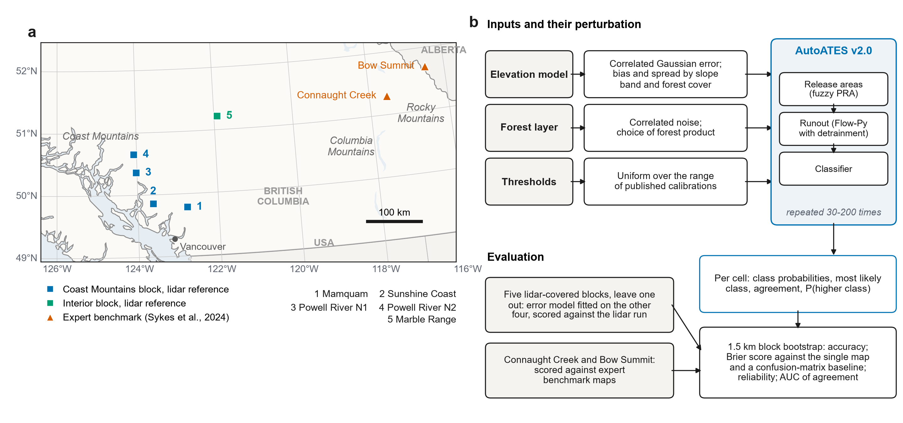
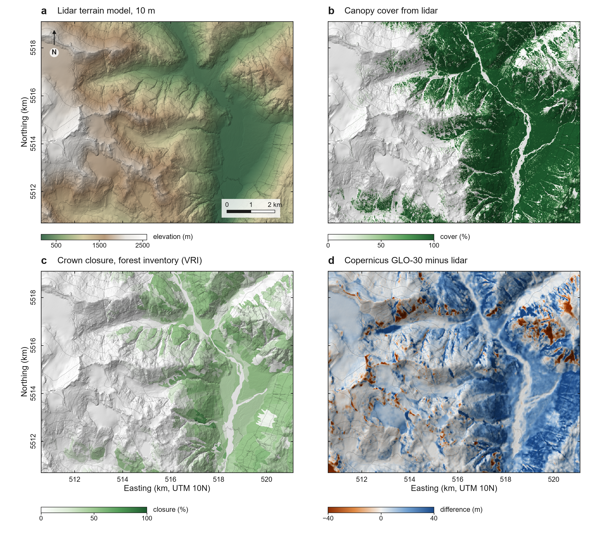
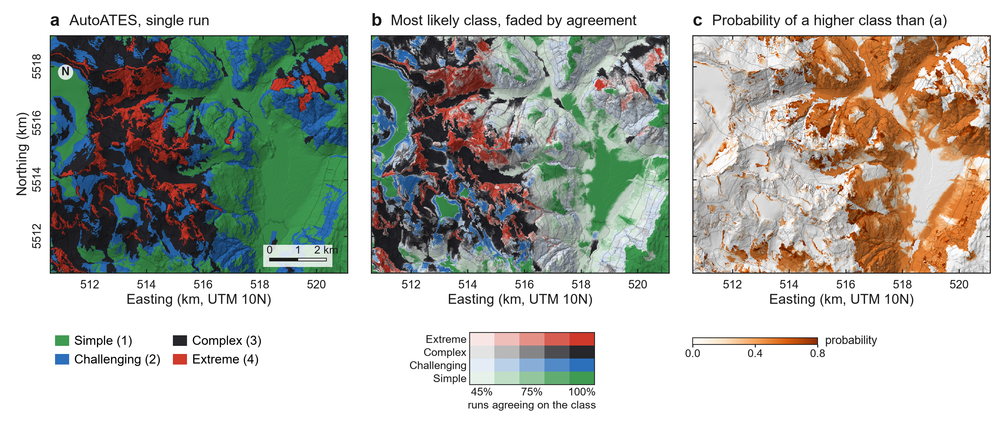
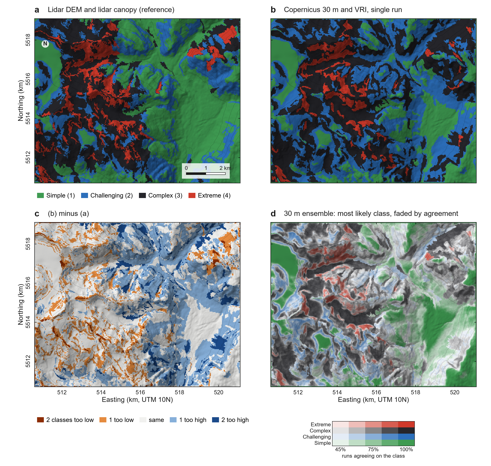
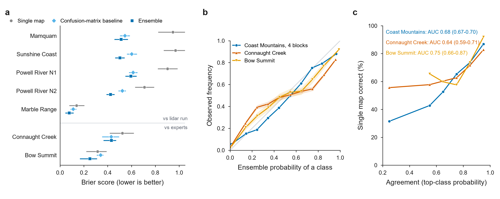
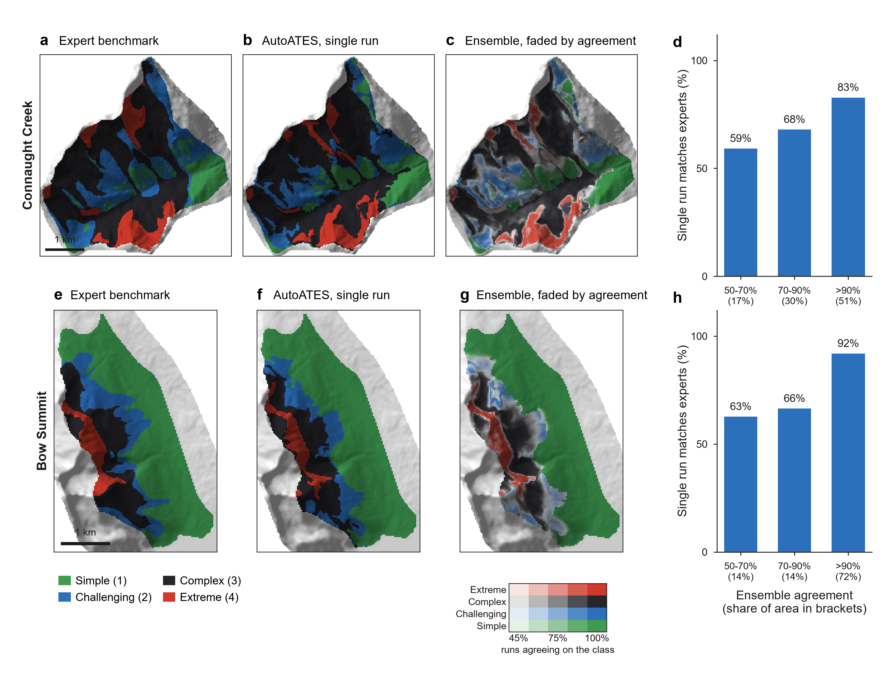
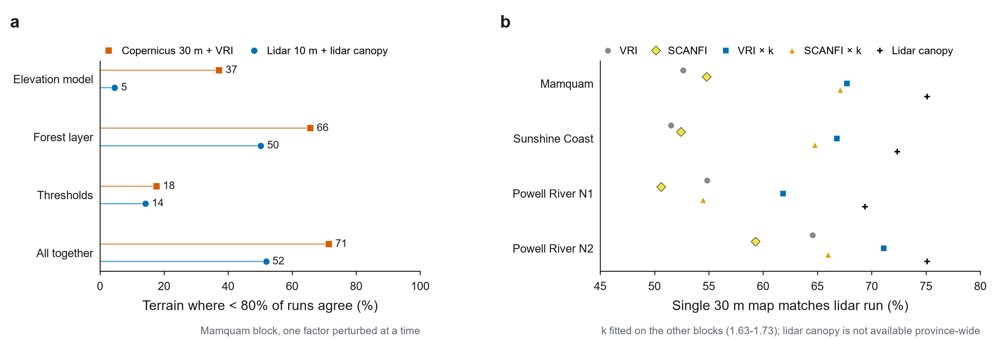

# How far can an automated avalanche terrain map be trusted? Propagating input uncertainty through AutoATES v2.0 in the Coast Mountains of British Columbia

**Yanice Zeng**

Independent researcher, Vancouver, British Columbia, Canada

*Manuscript draft, November 2026. Not peer reviewed.*

---

## Abstract

Automated mapping of the Avalanche Terrain Exposure Scale (ATES) now covers
whole regions, but each grid cell receives a single class with no measure of how
reliable it is. Where lidar is unavailable, the maps rest on 30 m elevation
models and forest inventories whose errors are largest in steep, forested
terrain. We reimplemented the AutoATES v2.0 model chain (release areas, Flow-Py
runout with forest detrainment, and classification) so that it runs in seconds,
verified it against the published code and data, and propagated three sources
of uncertainty through it by Monte Carlo simulation: spatially correlated
elevation error fitted against lidar, forest-layer error, and the spread of
published classifier thresholds. We evaluated the resulting class probabilities
at five lidar-covered 10.5 km × 8.4 km blocks in British Columbia, four of them
in the Coast Mountains where no AutoATES validation has been published, with
the error model fitted on the other blocks each time, and at two sites with
expert benchmark maps. Built from province-wide inputs, a single map agreed with
the lidar-based map on 55.9 % of cells (95 % block-bootstrap interval
53.4–58.2 %) across the four Coast Mountains blocks. The ensemble probabilities
were nearly calibrated against the lidar reference (expected calibration error
0.04) and improved the Brier score by 11 % (9–13 %) over a fair baseline that
assigns each single-map class its out-of-sample confusion frequencies. Agreement
between ensemble members ranked cells by whether the single map was right with
an area under the curve of 0.68 (0.67–0.70) against lidar and 0.64 and 0.75
against the expert maps. Against expert judgement, however, the probabilities
were overconfident and the most likely class was no more accurate than a single
calibrated run. Forest cover was the dominant source of uncertainty with and
without lidar elevation. Both the provincial forest inventory and the national
SCANFI product read 10–26 points below lidar canopy cover in the Coast
Mountains blocks, and a single scale factor that transfers between blocks
raised single-map agreement from 55.9 % to 66.9 %. We suggest that automated
ATES maps be published with an ensemble-agreement layer to direct expert
review, and that forest cover be treated as the first input to improve. The
maps are not intended for route-finding decisions.

---

## 1 Introduction

The Avalanche Terrain Exposure Scale (ATES) rates terrain by its exposure to
avalanches, independent of daily conditions, in five classes from
non-avalanche terrain (0) to extreme (4) (Statham et al., 2006; Statham and
Campbell, 2025). Manual ATES maps are costly, so they exist mainly for popular
areas. Automated methods now fill the gap: Larsen et al. (2020) mapped avalanche terrain
across Norway, AutoATES v2.0 combines a fuzzy-logic release-area model, the
Flow-Py runout model and a rule-based classifier (Toft et al., 2024), and Sykes
et al. (2024) optimized and validated it against expert benchmark maps in
western Canada. Random forests have also been trained to replace the rule-based
classifier (Markov et al., 2025).

These maps assign one class per cell. They do not say where that class is
fragile: where a slightly different elevation model, a different forest
product, or a different but equally defensible set of thresholds would change
it. That matters because the inputs available over large areas are imperfect.
Global 30 m elevation models smooth ridges and gullies and carry the height of
the forest canopy, and slope errors propagate non-linearly through any
threshold-based classification (Hunter and Goodchild, 1997; Wechsler, 2007).
Forest inventories describe stands for timber management, not the canopy
openness that controls avalanche release and runout. Sykes et al. (2024)
identified elevation and forest data as open challenges, Toft et al. (2024)
cautioned against applying the parameters to new regions without local
calibration, and Statham and Campbell (2025) recommended that automatically generated maps report their
error. Neither AutoATES study propagated input uncertainty to
the map, and maritime snow climates such as the Coast Mountains of British
Columbia have not been validated.

This study asks three questions. (1) If the uncertainty in the inputs and
thresholds is propagated through the full AutoATES chain, are the resulting
class probabilities calibrated, and do they add information beyond a single map?
(2) Does that hold on terrain not used to fit the error model, and against expert
judgement as well as against a lidar-based map? (3) Which input dominates the
uncertainty, and can province-wide data be improved cheaply?

## 2 Data and study areas

### 2.1 Coast Mountains blocks

We searched the Natural Resources Canada High Resolution Digital Elevation
Model mosaic (HRDEM, CanElevation series), which in British Columbia is built
from public lidar, for 10.5 km × 8.4 km blocks that are fully covered and
contain both alpine terrain (> 1500 m) and terrain below 1200 m. The search
ranked windows by coverage and elevation mix only. It returned four blocks in
the southern Coast Mountains and one in the Marble Range on the interior
plateau (Fig. 1a, Table 1). Mamquam, east of the Mamquam Icefield in Garibaldi
Provincial Park, was analysed first and in most detail.

**Table 1.** Study blocks. All are 10.5 km × 8.4 km in NAD83(CSRS) / UTM zone 10N.
The class shares are from the lidar-based reference map.

| No. | Block | Centre | Elevation (m) | Simple / challenging / complex / extreme (%) |
|---|---|---|---|---|
| 1 | Mamquam | 49.79° N, 122.78° W | 175–2580 | 40 / 22 / 28 / 10 |
| 2 | Sunshine Coast | 49.86° N, 123.62° W | 85–2111 | 35 / 26 / 30 / 9 |
| 3 | Powell River N1 | 50.36° N, 124.02° W | 214–2439 | 22 / 19 / 37 / 21 |
| 4 | Powell River N2 | 50.66° N, 124.07° W | 47–2512 | 26 / 19 / 40 / 16 |
| 5 | Marble Range (interior) | 51.22° N, 121.92° W | 923–2241 | 96 / 1 / 3 / 0 |

For each block we used:

- **Lidar terrain and surface models**, HRDEM mosaic at 2 m, averaged to 10 m.
- **Lidar canopy cover**, the share of 2 m cells per 10 m or 30 m cell where the
  surface model exceeds the terrain model by more than 2 m plus the local relief
  of one 2 m cell (cell size × slope gradient). Without this allowance, cliffs
  above treeline appeared as one-third forest.
- **Copernicus GLO-30**, the 30 m global elevation model (ESA, 2022). Two blocks
  straddle a 1° tile edge; cells within about 100 m of the edge were filled
  from their neighbours because bilinear resampling mixes in values from
  beyond the tile.
- **VRI crown closure**, from the British Columbia Vegetation Resources
  Inventory polygons, rasterized at 10 m and 30 m.
- **SCANFI crown closure**, the national 30 m product for 2020 (Guindon et al.,
  2024).

### 2.2 Expert benchmark sites

Sykes et al. (2024) published expert ATES benchmark maps, three independent
manual maps, and the AutoATES inputs and outputs for Connaught Creek (Glacier
National Park, British Columbia; transitional snow climate with strong maritime
influence) and Bow Summit (Banff National Park, Alberta; continental) (Toft et
al., 2023). We used the 26 m ALOS elevation model, the basal-area forest layer
and the site-specific optimized thresholds from those archives. Connaught Creek
also has a 5 m lidar elevation model, which we used to fit the ALOS error model.

## 3 Methods

### 3.1 Reimplementation and verification

The public AutoATES v2.0 code writes intermediate rasters to disk at every step,
and its Flow-Py component creates a Python object for every visited cell, which
makes thousands of runs impractical. We ported the release-area model, Flow-Py
with forest detrainment and the classifier to in-memory Python, with the two
inner loops compiled by Numba. The arithmetic, the order in which Flow-Py visits
cells, and the classifier's lookup table were kept unchanged. The port was
checked in four ways (Table 2). One warm run of the full chain on the 840 × 1050
Mamquam grid at 10 m, with about 160 000 release cells, takes about 13 s on a
32-thread desktop processor.

**Table 2.** Verification of the reimplementation.

| Check | Result |
|---|---|
| Classifier on the bundled Bow Summit inputs vs. bundled outputs, all seven intermediate rasters | identical, cell for cell |
| Release-area model on the bundled test DEM vs. bundled outputs | wind shelter within 10-5; continuous and binary release layers identical |
| Flow-Py vs. the unmodified upstream Python code, 90 × 90 window | identical cell counts; energy-line height and travel angle within 10-3 |
| Full chain from DEM and forest layer vs. archived AutoATES maps | 98.5 % (Connaught Creek) and 99.2 % (Bow Summit) of cells identical; published accuracies of 75.1 % and 84.4 % reproduced |

Settings follow the published values: release-area wind-shelter radius 60 m,
release threshold 0.15 and a 3-cell sieve; Flow-Py maximum alpha angle 24°,
exponent 8, flux threshold 0.003 and maximum energy-line height 270 m (Sykes et
al., 2024); and the overhead-exposure layer as the mean of the scaled
energy-line height and the scaled natural logarithm of the cell count, a form
that reproduces the bundled overhead layer to within integer rounding.

### 3.2 Uncertainty model

Each ensemble member perturbs some or all of three inputs and reruns the whole
chain.

**Elevation.** Copernicus minus lidar was computed on the 30 m grid and divided
into eight strata that can be formed without lidar: four Copernicus slope bands
(0–15°, 15–30°, 30–45° and > 45°) by VRI forest (crown closure ≥ 10 %) or open
terrain. Each member removes the stratum bias and adds a zero-mean Gaussian
random field scaled by the stratum standard deviation. The field is white noise
smoothed by a Gaussian filter, and its width was chosen so that the simulated
slope error matched the observed slope error of Copernicus against lidar
(5.4° standard deviation at Mamquam). For the lidar configuration a nominal
0.5 m standard deviation was assumed, as no independent check data were
available. At the benchmark sites the ALOS error model was fitted at Connaught
Creek against its lidar DEM (slope error 3.4°) and transferred unchanged to Bow
Summit.

**Forest.** Each member adds a smoothed Gaussian field (standard deviation
15 points for 30 m crown closure, 10 points for lidar canopy cover, 5 m² ha⁻¹
for basal area) and, where two forest products exist, draws one of them at
random.

**Thresholds.** Integer values are drawn uniformly over the range spanned by the
AutoATES v2.0 defaults and the grid-search optima of Sykes et al. (2024) for two
sites and four elevation models: slope thresholds 18–19°, 28–31° and 37–40°,
the complex alpha angle 33–34°, the challenging/complex overhead-exposure
threshold 25–40, and the canopy-cover thresholds 10–20 %, 50–55 % and 65–75 %.
The release-area and Flow-Py settings were held at their published values
because only one value of each has been published, so the threshold spread is a
lower bound on parameter uncertainty.

For each cell the ensemble yields a class probability (the share of members
giving that class), the most likely class, the agreement (the probability of
the most likely class), and the probability that the class is higher than in
the single, unperturbed map.

### 3.3 Experiments

1. **Within-block attribution (Mamquam).** One factor perturbed at a time, then
   all together, for two configurations: Copernicus 30 m with VRI (150 members
   per factor, 200 for all factors) and lidar 10 m with lidar canopy (30 per
   factor, 60 for all). The error model was fitted on the same block.
2. **Leave one block out.** For each of the five blocks, the elevation error
   strata, the correlation length and the forest scale factors (Sect. 3.4) were
   fitted on the other four, and a 120-member ensemble with all inputs
   perturbed was run on the held-out block from Copernicus elevation, once with
   VRI and once with SCANFI as the base forest layer. The reference is the
   single AutoATES run from lidar elevation and lidar canopy cover, aggregated
   from 10 m to 30 m by majority.
3. **Expert benchmarks.** At Connaught Creek and Bow Summit, ensembles of 100
   members per factor and 200 with inputs only or all factors were scored
   against the expert benchmark maps, counting class 0 as class 1 as Sykes et
   al. (2024) did.

### 3.4 Province-wide forest layers

VRI and SCANFI report crown closure, while AutoATES' canopy-cover thresholds
were set for canopy cover. We tested a single multiplicative factor *k* that
maps crown closure onto lidar canopy cover, fitted by least squares through the
origin on the cells with non-zero crown closure in the training blocks only.

### 3.5 Scores and intervals

For each area we report the share of cells where the single map or the
ensemble's most likely class matches the reference, and the multi-class Brier
score (Brier, 1950). A single map scored as a one-hot forecast is a weak
baseline, because any spread of probability lowers its Brier score. We therefore
also scored a confusion-matrix baseline, which replaces each single-map class
*i* by the frequencies P(reference = *j* | single = *i*) estimated on the other
areas only, and report the Brier skill score of the ensemble relative to it.
Calibration is shown in reliability diagrams (Bröcker and Smith, 2007) and
summarized by the top-label expected calibration error over ten equal-width
bins (Guo et al., 2017). The area under the receiver operating characteristic
curve (AUC) measures how well agreement ranks the cells where the single map is
right above those where it is wrong. All intervals are 95 % percentile
intervals from 2000 bootstrap resamples of 1.5 km square blocks, which
accounts for spatial autocorrelation (Roberts et al., 2017); pooled Coast
Mountains intervals resample within each block.

## 4 Results

### 4.1 Inputs at Mamquam

Copernicus GLO-30 was 10.2 m above the lidar terrain model on average, with a
standard deviation of 16.4 m (Fig. 2d). The bias was 3–5 m in open terrain and
13–19 m under forest, where the radar-derived surface includes part of the
canopy. Crown closure from VRI averaged 26 points below lidar canopy cover
(Fig. 2b, c), and replacing one with the other on the same lidar elevation
model changed the class of 41 % of cells.

**Figure 1.** (a) Study areas: four Coast Mountains blocks and one interior block
with full lidar coverage, and the two expert benchmark sites of Sykes et al.
(2024). (b) Workflow. Each ensemble member perturbs the inputs and reruns the
whole AutoATES v2.0 chain.

**Figure 2.** Inputs at Mamquam. (a) Lidar terrain model at 10 m. (b) Canopy
cover from lidar. (c) Crown closure from the BC Vegetation Resources Inventory.
(d) Copernicus GLO-30 minus the lidar terrain model at 30 m. Contours every
200 m.

### 4.2 What the ensemble shows within one block

With lidar elevation and lidar canopy cover, the single map (Fig. 3a) hides
substantial disagreement among ensemble members (Fig. 3b): 52 % of the block has
a class that holds in fewer than 80 % of members. The least stable terrain is
the challenging class, where only 22 % of cells hold their class in 80 % or more
of members, followed by simple terrain (39 %). Complex and extreme terrain are
the most stable (74 % and 72 %). Where the single map says simple or
challenging, the probability that the class is higher exceeds 0.2 on 61 % and
74 % of cells respectively (Fig. 3c).

**Figure 3.** Mamquam, lidar 10 m with lidar canopy cover. (a) Single AutoATES
run. (b) Most likely class of a 60-member ensemble, faded towards white as
agreement between members falls. (c) Probability that the class is higher than
in (a). ATES colours follow the convention of the scale (green, blue, black,
red).

From province-wide inputs, the single 30 m map agreed with the lidar-based map on
52.6 % of cells and rated 12.6 % lower and 34.8 % higher (Fig. 4a–c). The
higher ratings lie mostly under forest, where VRI understates canopy cover, and
the lower ratings mostly on steep open ground, where the 30 m model smooths
slopes (Fig. 4c).

**Figure 4.** Mamquam. (a) Lidar-based map aggregated to 30 m (reference).
(b) Single map from Copernicus GLO-30 and VRI. (c) Difference. (d) Most likely
class of the 30 m ensemble with the error model fitted on this block, faded by
agreement.

### 4.3 Leave one block out

On blocks not used to fit the error model, the pattern held (Table 3, Fig. 5).
Across the four Coast Mountains blocks the single 30 m map matched the
lidar-based map on 55.9 % (53.4–58.2 %) of cells and the ensemble's most likely
class on 63.5 % (61.4–65.5 %). The ensemble was close to calibrated (expected
calibration error 0.04, 0.03–0.05), with a mild tendency to overconfidence at
high probabilities (Fig. 5b). Its Brier score was 42 % lower than that of the
single map scored as a one-hot forecast, but only 11 % (9–13 %) lower than the
confusion-matrix baseline. Most of the apparent gain over a single map is
therefore the honest statement that 30 m maps are often wrong; the remaining
11 % comes from the ensemble's ability to say *which* cells are likely wrong.
That ability is moderate: agreement separates correct from incorrect single-map
cells with an AUC of 0.68 (0.67–0.70), and single-map accuracy rises from about
31 % where agreement is below 0.5 to 87 % where it exceeds 0.9 (Fig. 5c).

**Table 3.** Leave one block out, Copernicus 30 m with VRI. Values in brackets
are 95 % block-bootstrap intervals. BSS, Brier skill score of the ensemble
relative to the confusion-matrix baseline; ECE, expected calibration error;
AUC, agreement as a predictor of single-map correctness.

| Block | Single map correct (%) | Most likely class correct (%) | BSS | ECE | AUC |
|---|---|---|---|---|---|
| Mamquam | 52.6 (46.4–58.8) | 62.5 (57.4–67.6) | 0.06 (0.01–0.11) | 0.05 | 0.67 (0.63–0.71) |
| Sunshine Coast | 51.5 (46.7–56.5) | 62.9 (59.2–66.5) | 0.17 (0.13–0.20) | 0.04 | 0.74 (0.70–0.77) |
| Powell River N1 | 54.8 (50.7–59.0) | 57.4 (53.5–61.4) | 0.03 (−0.01–0.07) | 0.09 | 0.64 (0.61–0.68) |
| Powell River N2 | 64.6 (60.5–68.5) | 71.1 (68.3–74.0) | 0.19 (0.15–0.23) | 0.06 | 0.69 (0.65–0.72) |
| Coast Mountains, pooled | 55.9 (53.4–58.2) | 63.5 (61.4–65.5) | 0.11 (0.09–0.13) | 0.04 | 0.68 (0.67–0.70) |
| Marble Range (interior) | 93.1 (89.8–96.1) | 94.5 (91.6–97.1) | 0.30 (0.15–0.50) | 0.02 | 0.96 (0.95–0.98) |

Powell River N1, the steepest block (21 % extreme terrain; Copernicus slope
error 6.9°), was the weakest: the ensemble barely beat the baseline and was the
most overconfident. The Marble Range block is 96 % simple terrain, so its high
scores say little about avalanche terrain.

**Figure 5.** Skill and calibration. (a) Brier score of the single map, the
confusion-matrix baseline and the ensemble, with 95 % block-bootstrap
intervals; the five blocks are scored against their lidar-based maps with the
error model fitted on the other blocks, the two benchmark sites against expert
maps. (b) Reliability, pooled over classes 1–4, with 95 % Wilson intervals on
the observed frequency. (c) Single-map accuracy against ensemble agreement,
with the AUC and its interval.

### 4.4 Against expert benchmark maps

Against expert judgement (Fig. 5, Fig. 7), agreement again pointed to where the
single map was wrong: single-map accuracy was 83 % at Connaught Creek and 92 %
at Bow Summit where more than 90 % of members agreed, against 59 % and 63 %
where 50–70 % agreed, and the AUC was 0.64 (0.59–0.71) and 0.75 (0.66–0.87).
Where the three independent manual maps disagreed with one another, the
ensemble was also less sure: cells with agreement below 0.8 made up 45 % of the
area where the mappers disagreed and 9 % where they agreed at Bow Summit, and
36 % and 27 % at Connaught Creek.

The probabilities were nevertheless overconfident against experts (expected
calibration error 0.13 and 0.07; a stated 0.93 was right 79 % of the time at
Connaught Creek), and the most likely class was no more accurate than the single
calibrated run (71.2 % against 73.8 % at Connaught Creek, 83.5 % against 84.2 %
at Bow Summit). The Brier skill score relative to the confusion-matrix baseline
was −0.00 (−0.15–0.09) at Connaught Creek and 0.27 (0.11–0.47) at Bow Summit,
where the baseline transferred from Connaught Creek was itself poorly suited.
With 13 and 10 bootstrap blocks, these intervals are wide.

**Figure 7.** Expert benchmark sites. (a, e) Expert benchmark maps of Sykes et
al. (2024). (b, f) Single AutoATES run with the site-specific optimized
thresholds. (c, g) Most likely class of the 200-member ensemble, faded by
agreement. (d, h) Single-map accuracy against the expert map by agreement
class; the share of area is in brackets. Bins holding less than 3 % of the
area are omitted.

### 4.5 Sources of uncertainty and province-wide forest layers

At Mamquam, perturbing the forest layer alone left 66 % of the block with
agreement below 0.8 with 30 m inputs, and 50 % even with lidar elevation and
lidar canopy (Fig. 6a). Elevation error mattered at 30 m (37 %) but hardly with
lidar (5 %). Threshold spread contributed 18 % and 14 %.

Both province-wide forest layers read well below lidar canopy cover: VRI by 12
to 26 points and SCANFI by 10 to 21 points in the Coast Mountains blocks, and
both by over 30 points in the Marble Range. The scale factor *k* fitted on the
other blocks varied little (1.65–1.73 for VRI, 1.63–1.68 for SCANFI). Scaling
raised single-map agreement with the lidar-based map from 55.9 % to 66.9 % with
VRI and from 54.3 % to 63.1 % with SCANFI, against 73.0 % with lidar canopy
cover on the same Copernicus elevation model (Fig. 6b). SCANFI was not better
than VRI in these blocks.

**Figure 6.** (a) Share of Mamquam where fewer than 80 % of members agree,
perturbing one factor at a time. (b) Single 30 m map agreement with the
lidar-based map for each forest layer in the four Coast Mountains blocks; *k*
is fitted on the other blocks. Lidar canopy cover is an upper bound, as it is
not available province-wide.

## 5 Discussion

### 5.1 What the agreement layer is good for

The ensemble does two things well and one thing poorly. It says honestly how
often a 30 m map built from province-wide data is wrong, which a single map
cannot. It ranks cells by how likely the single map is to be wrong, which is
useful for directing expert review: flagging the 22 % of the Coast Mountains
area where the probability of a higher class exceeds 0.2 captured 58 %
(56–60 %) of the cells that the single map rated too low. It does not produce
a more accurate map, and its probabilities should not be read as calibrated
against expert judgement. We therefore suggest publishing an agreement layer
alongside automated ATES maps as a review aid rather than replacing the class
map with probabilities.

### 5.2 Why the probabilities are overconfident against experts

The ensemble only varies the inputs and thresholds. It cannot represent the
ways in which the model structure differs from expert judgement: a release
area that the fuzzy model misses in every member, a runout shaped by terrain
features finer than the elevation model, or an expert's view of terrain
connectivity. Against the lidar-based reference, which shares the model
structure, the ensemble is nearly calibrated; against experts, the structural
error remains. A structural term, for example sampling the release-area and
Flow-Py settings or alternative classifiers such as random forests (Markov et
al., 2025), would be needed to close that gap.

### 5.3 Forest cover first

Forest cover dominated the uncertainty in every configuration. Crown closure
from inventories and canopy cover from lidar are different quantities, and the
AutoATES canopy thresholds read both the same way. A single scale factor
recovered most of the difference and transferred between blocks, which
suggests that a provincial calibration of crown closure against lidar is a
cheap way to improve automated ATES maps where lidar elevation is missing.
Whether scaled crown closure also moves the maps closer to expert judgement
remains untested, since the benchmark sites use basal area.

### 5.4 A note on the Bow Summit archive

In the archived Bow Summit inputs (Toft et al., 2023), the forest-density layer
passed to Flow-Py is −9999 in 14 221 of 31 118 study-area cells, the cells where
basal area is zero; at Connaught Creek the same layer is zero there. Flow-Py does
not treat −9999 as missing: its detrainment term becomes negligible below an
energy-line height of about 65 m and exceeds the whole flux above it, so flows
over open terrain stop early. Passing the layer as archived reproduces the
published map and its 84.4 % accuracy; replacing −9999 by zero gives 78.1 %, with
challenging terrain falling from 57 % to 29 %. We have asked the authors whether
this was intended and report it as an observation about the archived files,
not as an error in the published study.

### 5.5 Limitations

The Coast Mountains reference is AutoATES run on lidar, not expert judgement, so
those results measure sensitivity to input data rather than correctness. The
four Coast Mountains blocks lie within about 120 km of one another; the North
Shore mountains, the northern Coast Mountains and Vancouver Island are not
represented. The lidar elevation error and the forest noise levels are
assumptions. The release-area and Flow-Py settings were not perturbed. The
overhead-exposure layer is scaled by the largest cell count in the scene, as in
the original code, so it depends on the extent of the study area. ATES describes
terrain, not conditions on a given day, and nothing here is suitable for
route-finding decisions.

## 6 Conclusions

Propagating input and threshold uncertainty through AutoATES v2.0 showed that a
30 m map built from province-wide data agrees with a lidar-based map on little
more than half of the Coast Mountains terrain studied, and that the ensemble
says honestly where that agreement is likely to fail. The probabilities were
nearly calibrated against the lidar-based maps on blocks not used for fitting,
but overconfident against expert maps, and they added 11 % in Brier skill over
a fair baseline rather than the 42 % that a comparison with a single map
suggests. The most useful product is an agreement layer that ranks terrain for
expert review. Forest cover, not elevation, was the largest source of
uncertainty, and a single, transferable scale factor on crown closure closed
much of the gap to lidar canopy cover.

---

## Code and data availability

Code, figures and summary statistics: https://github.com/YaniceZ/autoates-bc
(GPL-3.0-or-later). The repository includes scripts that download all inputs.
Inputs: NRCan HRDEM mosaic (CanElevation series, Open Government Licence –
Canada); Copernicus DEM GLO-30 (ESA, 2022); BC Vegetation Resources Inventory
(Open Government Licence – British Columbia); SCANFI (Guindon et al., 2024);
benchmark maps and AutoATES inputs for Connaught Creek and Bow Summit (Toft et
al., 2023); Natural Earth boundaries (public domain).

## Author contributions

YZ designed the study, ran the analysis and wrote the manuscript.

## Use of AI tools

Code, analysis and text were developed with the assistance of a large language
model (Claude, Anthropic). The author reviewed the outputs and is responsible
for the content.

## Competing interests

The author declares no competing interests.

## Acknowledgements

We thank the AutoATES and Flow-Py authors for publishing their code, data and
benchmark maps under open licences.

## References

Brier, G. W.: Verification of forecasts expressed in terms of probability, Mon. Weather Rev., 78, 1–3, https://doi.org/10.1175/1520-0493(1950)078<0001:VOFEIT>2.0.CO;2, 1950.

Bröcker, J. and Smith, L. A.: Increasing the reliability of reliability diagrams, Weather Forecast., 22, 651–661, https://doi.org/10.1175/WAF993.1, 2007.

D'Amboise, C. J. L., Neuhauser, M., Teich, M., Huber, A., Kofler, A., Perzl, F., Fromm, R., Kleemayr, K., and Fischer, J.-T.: Flow-Py v1.0: a customizable, open-source simulation tool to estimate runout and intensity of gravitational mass flows, Geosci. Model Dev., 15, 2423–2439, https://doi.org/10.5194/gmd-15-2423-2022, 2022.

ESA: Copernicus DEM, European Space Agency, https://doi.org/10.5270/ESA-c5d3d65, 2022.

Guindon, L., Manka, F., Correia, D. L. P., Villemaire, P., Smiley, B., Bernier, P., Gauthier, S., Beaudoin, A., Boucher, J., and Boulanger, Y.: A new approach for spatializing the Canadian National Forest Inventory (SCANFI) using Landsat dense time series, Can. J. Forest Res., 54, 793–815, https://doi.org/10.1139/cjfr-2023-0118, 2024.

Guo, C., Pleiss, G., Sun, Y., and Weinberger, K. Q.: On calibration of modern neural networks, in: Proceedings of the 34th International Conference on Machine Learning, PMLR, 70, 1321–1330, 2017.

Hunter, G. J. and Goodchild, M. F.: Modeling the uncertainty of slope and aspect estimates derived from spatial databases, Geogr. Anal., 29, 35–49, https://doi.org/10.1111/j.1538-4632.1997.tb00944.x, 1997.

Larsen, H. T., Hendrikx, J., Slåtten, M. S., and Engeset, R. V.: Developing nationwide avalanche terrain maps for Norway, Nat. Hazards, 103, 2829–2847, https://doi.org/10.1007/s11069-020-04104-7, 2020.

Markov, K., Huber, A., Panayotov, M., Hesselbach, C., Spannring, P., Fischer, J.-T., and Teich, M.: Machine learning for automated avalanche terrain exposure scale (ATES) classification, Nat. Hazards Earth Syst. Sci., 25, 4375–4403, https://doi.org/10.5194/nhess-25-4375-2025, 2025.

Roberts, D. R., Bahn, V., Ciuti, S., Boyce, M. S., Elith, J., Guillera-Arroita, G., Hauenstein, S., Lahoz-Monfort, J. J., Schröder, B., Thuiller, W., Warton, D. I., Wintle, B. A., Hartig, F., and Dormann, C. F.: Cross-validation strategies for data with temporal, spatial, hierarchical, or phylogenetic structure, Ecography, 40, 913–929, https://doi.org/10.1111/ecog.02881, 2017.

Statham, G. and Campbell, C.: The Avalanche Terrain Exposure Scale (ATES) v.2, Nat. Hazards Earth Syst. Sci., 25, 1113–1137, https://doi.org/10.5194/nhess-25-1113-2025, 2025.

Statham, G., McMahon, B., and Tomm, I.: The Avalanche Terrain Exposure Scale, in: Proceedings of the International Snow Science Workshop, Telluride, Colorado, USA, 2006.

Sykes, J., Toft, H., Haegeli, P., and Statham, G.: Automated Avalanche Terrain Exposure Scale (ATES) mapping – local validation and optimization in western Canada, Nat. Hazards Earth Syst. Sci., 24, 947–971, https://doi.org/10.5194/nhess-24-947-2024, 2024.

Toft, H. B., Haegeli, P., and Sykes, J.: Automated Avalanche Terrain Exposure Scale (ATES) mapping – Local validation and optimization in Western Canada [data set], OSF, https://doi.org/10.17605/OSF.IO/ZXJW5, 2023.

Toft, H. B., Sykes, J., Schauer, A., Hendrikx, J., and Hetland, A.: AutoATES v2.0: Automated Avalanche Terrain Exposure Scale mapping, Nat. Hazards Earth Syst. Sci., 24, 1779–1793, https://doi.org/10.5194/nhess-24-1779-2024, 2024.

Veitinger, J., Purves, R. S., and Sovilla, B.: Potential slab avalanche release area identification from estimated winter terrain: a multi-scale, fuzzy logic approach, Nat. Hazards Earth Syst. Sci., 16, 2211–2225, https://doi.org/10.5194/nhess-16-2211-2016, 2016.

Wechsler, S. P.: Uncertainties associated with digital elevation models for hydrologic applications: a review, Hydrol. Earth Syst. Sci., 11, 1481–1500, https://doi.org/10.5194/hess-11-1481-2007, 2007.
